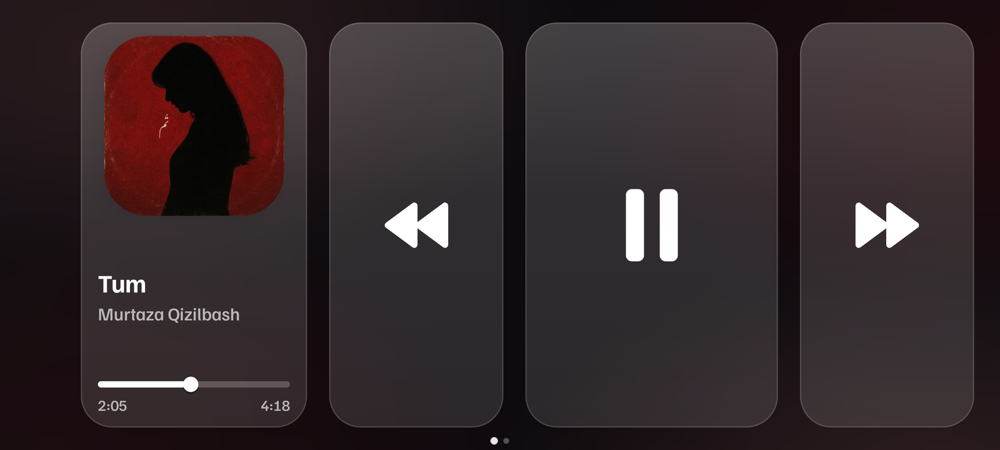
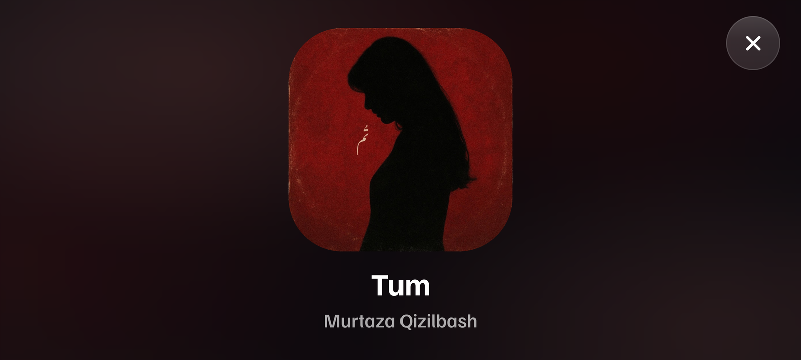
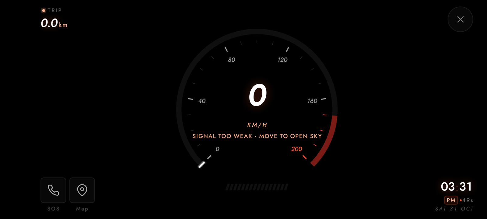
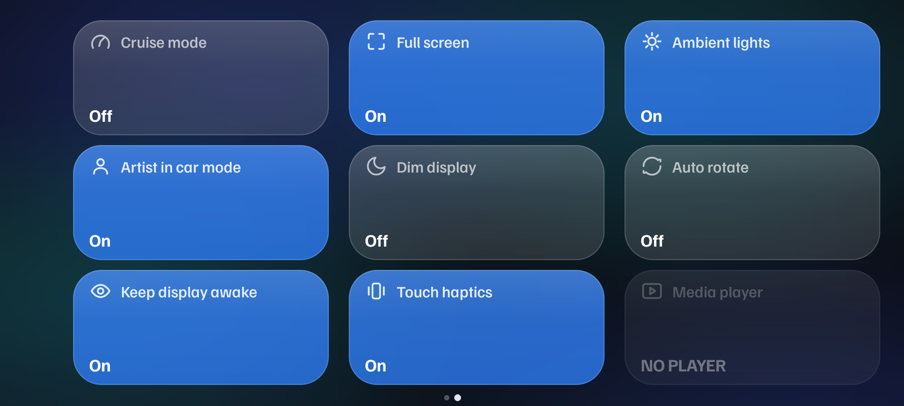

# Cruise: Android Car Dashboard, Media Remote and GPS Speedometer

Cruise is a landscape Android app for the car: a media remote for whatever player is already
running on the phone, plus a GPS speedometer with a trip meter. It is built in Kotlin with
Jetpack Compose and controls Spotify, YouTube Music, or any Android app that publishes a
media session.

**[Download the latest APK →](https://github.com/tzmughal/cruise-android-car-dashboard/releases/latest)**

It is **not** a media player. Cruise has no library, playlists, accounts, or downloads, and it
does not play audio. It reads the media session that another app publishes and sends transport
commands to it. Your existing player keeps doing the work. Spotify stays Spotify, your local
player stays your local player, so there is nothing to import, sync, or move.

| Media remote | Car mode |
| --- | --- |
|  |  |
| **Speedometer** | **Settings** |
|  |  |

## What it is and isn't

| It is | It isn't |
| --- | --- |
| A front end for the media session already active on your phone | A music player or streaming service |
| A transport remote: previous, play/pause, next, seek | A place to store or manage a music library |
| Independent of any one app: works with anything that publishes a `MediaSession` | Tied to a specific service, account, or subscription |
| A GPS speedometer with a trip meter | A calibrated vehicle instrument |

Because it only drives an existing session, installing Cruise changes nothing about your
playlists, favourites, history, or audio output. If an app can be controlled from a headset
button or a car head unit, Cruise can control it.

## Features

### Media control

- Live album art, title, artist, and playback progress from the active session.
- Previous, play/pause, and next, plus seeking when the player supports it.
- Position is projected from the session's reported position and playback speed, so progress
  keeps advancing between updates.
- A five-second refresh recovers from players that do not push session updates reliably.
- A playing session is preferred. If several are playing, the most recently updated one wins;
  when playback pauses, the current session is kept while it remains active.
- **Media player** opens the app that owns the active session, when it exposes a launch intent.

### Car mode

- Tap the album panel for a large-cover layout with title and artist.
- Background colours are sampled from the current album art and animate as tracks change.
- The artist line is optional; the close button returns to the media remote.

### GPS speedometer

- Speed in km/h on a custom-drawn gauge, with a trip meter and live signal state.
- Long-press the trip meter to reset it.
- Explicit states for permission required, location services off, searching, weak accuracy,
  unavailable, and locked (**GPS LOCKED · LIVE**).
- Fixes without accuracy data, or worse than 20 m, are never used to calculate speed.
- **SOS** opens the dialer without placing a call. **Map** opens a map app at the last fix.
- Clock, date, and session time on the dashboard.
- Track controls keep working without GPS; only the speed reading requires location.

### Interface

- Full-screen landscape layout that stays awake while Cruise is open.
- Ambient album-art lighting that can be switched off for a plain dark background.
- Window dimming that does not change the device's brightness setting.
- Haptic feedback on supported controls.
- Optional auto-rotate toggle, driven through Android's system setting.
- Settings tiles can be reordered by long-press and drag.

## Gestures

| Screen | Gesture | Action |
| --- | --- | --- |
| Home | Swipe left | Open Settings |
| Settings | Swipe right | Back to Home |
| Home | Tap album panel | Enter car mode |
| Car mode | Tap artwork | Play / pause |
| Car mode | Swipe left / right | Next / previous track |
| Car mode | Swipe up from the lower area | Reveal the seek bar |
| Car mode | Swipe down | Hide the seek bar |
| Car mode | Drag the seek bar | Seek in the current track |
| Speedometer | Tap the gauge | Play / pause |
| Speedometer | Swipe left / right | Next / previous track |
| Speedometer | Long-press the trip meter | Reset trip distance |
| Settings | Long-press and drag a tile | Reorder tiles |

Reordering is also available to screen readers through each tile's *move earlier* and
*move later* actions.

## Settings

| Tile | Behaviour |
| --- | --- |
| Cruise mode | Opens the GPS speedometer dashboard |
| Ambient lights | Enables album-art colours in the animated background |
| Full screen | Hides system bars; an edge swipe reveals them |
| Keep display awake | Stops the screen from timing out while Cruise is open |
| Artist in car mode | Shows or hides the artist line in car mode |
| Touch haptics | Haptic feedback on supported controls |
| Auto rotate | Toggles Android's system auto-rotate setting |
| Media player | Opens the app behind the active media session |
| Dim display | Dims Cruise's window without changing device brightness |

## Permissions

| Permission | Required | Purpose |
| --- | --- | --- |
| Notification access | Yes | Discover media sessions and send transport commands |
| Location (fine or coarse) | No | Speedometer only, requested when the mode is opened; no background location |
| Write system settings | No | The Auto rotate tile |
| Vibrate | No | Haptic feedback |

## How it works

1. A `NotificationListenerService` receives media-session callbacks and discovers players.
2. `MediaController` instances expose transport actions, metadata, and the reported playback
   position, which Cruise projects forward between updates.
3. Commands are dispatched to the selected controller; Cruise never touches the audio stream.
4. The UI is Jetpack Compose throughout, with custom drawing for the gauge and the animated
   background.

## Tech

Kotlin · Jetpack Compose · Material 3 · MediaSession / MediaController ·
NotificationListenerService · Fused location · Palette · Gradle · minSdk 26, targetSdk 35

## Roadmap

Planned for upcoming versions. No dates; detail will be tracked in the issue tracker.

- **Car connection prompt:** show a notification when the phone connects to the car over
  Bluetooth, offering to open Cruise directly in car mode.
- **Automatic auto-rotate:** turn auto-rotate on while Cruise is in the foreground, while the
  existing Settings tile stays available to switch it off or on manually.
- **OBD-II telemetry:** real-time vehicle data from a Bluetooth OBD-II adapter (engine RPM,
  coolant temperature, intake air, fuel trims) shown alongside the GPS speedometer.
- **UI refinements:** continued work on dashboard layout, typography, and transitions.

## Install

1. Download `Cruise.apk` from the **Releases** page.
2. Install it, allowing installs from unknown sources if prompted.
3. Open Cruise and choose **Open notification access**, then enable Cruise.
4. Start playback in any media app and return to Cruise.
5. Optional: Settings → **Cruise mode** and allow location for the speedometer.

This is a debug-signed build for personal use, not a Play Store release.

## Notes

- Speed is derived from GPS and depends on hardware, reception, and fix quality. It is not
  calibrated vehicle speed and should not be used as a vehicle instrument.
- Cruise can only control players that publish a standard Android media session and that
  advertise the corresponding transport actions. A player that does not support seeking
  cannot be seeked from Cruise.
- Cruise can open the dialer and a map app, but does not place calls or provide navigation.
